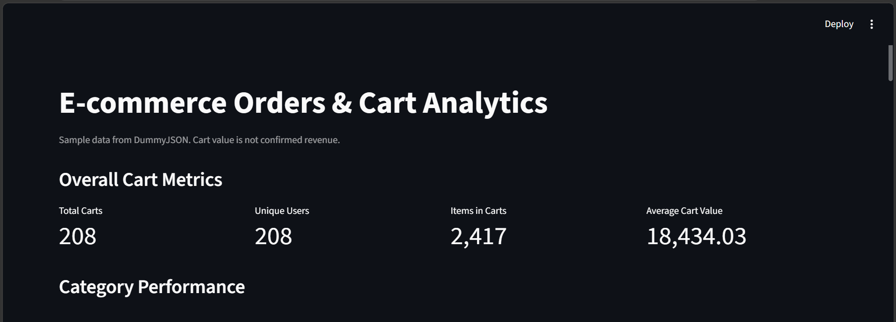
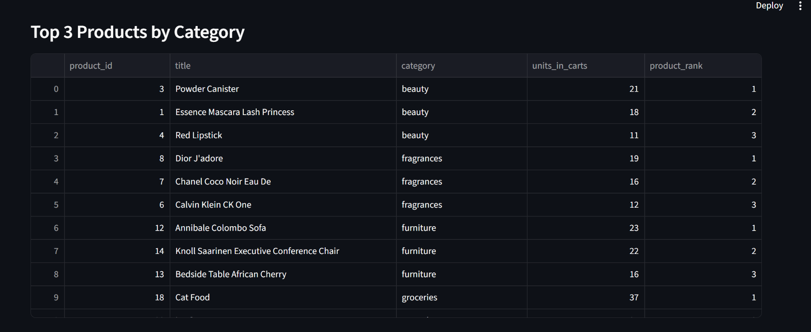
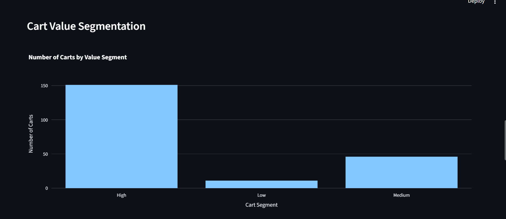
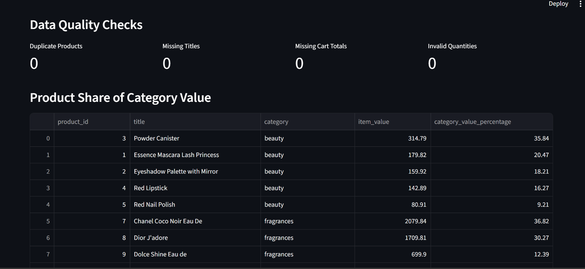

# 🛒 E-commerce Orders & Cart Analytics

## 📌 Project Overview

This project is an end-to-end e-commerce data analytics project built using **Python, SQL, SQLite, Streamlit**

The project fetches sample product and cart data from the **DummyJSON API**, stores the data in a relational SQLite database, performs data-quality validation and SQL-based analysis, and presents the results through an interactive Streamlit dashboard.

The project focuses on:

- Product demand analysis
- Category performance
- Cart value analysis
- Product ranking
- Cart segmentation
- Data quality validation
- Intermediate SQL and window functions

> **Important:** The project uses sample data from DummyJSON. Cart values are treated as **sample cart values** and should not be interpreted as confirmed business revenue.

---


## 🎯 Project Objectives

The main objectives of this project are:

1. Fetch e-commerce product and cart data from a public API.
2. Process and store the data in a relational SQLite database.
3. Validate the ingested data using SQL-based data-quality checks.
4. Analyze product and category performance using SQL.
5. Demonstrate intermediate SQL concepts and window functions.
6. Build an interactive dashboard using Streamlit and Plotly.
7. Present the results in a simple and business-friendly format.

---

## 📸 Dashboard Preview

### Dashboard Overview



### Product & Category Analysis



### Cart Value Analysis



### Data Quality Checks



##  AI assistance note

AI assistance was used to brainstorm a simple architecture, review code structure, and improve documentation. I checked the table design and query logic, kept the implementation to Python and  SQL, and chose SQLite/Streamlit to make the project easy to run and explain. Before submission, I ran the pipeline, checked the database rows, executed the SQL queries, and verified that the dashboard loads. I would only claim checks I personally completed.


## 🏗️ Project Architecture

```text
                 DummyJSON API
                      │
                      ▼
              Python Data Ingestion
                 fetch_data.py
                      │
                      ▼
                SQLite Database
               ecommerce.db
                      │
          ┌───────────┴───────────┐
          ▼                       ▼
   Data Quality Checks       SQL Analysis
                              analysis.sql
          │                       │
          └───────────┬───────────┘
                      ▼
             Streamlit Dashboard
                dashboard.py
                      │
                      ▼
              Business Insights


